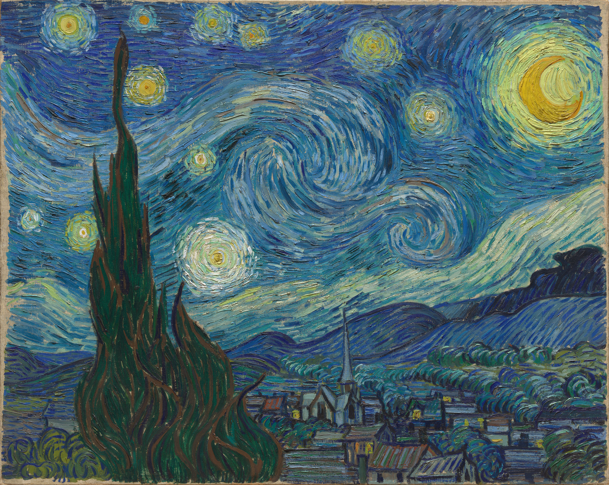

# 星夜 · 代码 — Starry Night of Code

> 一幅写给计算机历史的互动星空图。
> 以梵高《星月夜》（1889 · 公有领域）为幕，46 个改变计算世界的瞬间化作星辰，连成六个时代的星座。

**在线体验**：https://gatsby-code.github.io/starry-night-of-code/ （GitHub Pages，手机电脑均可直接打开）



## 这是什么

申请加入计算机协会的参赛作品，献给**软件开发部**与**人工智能部**——前者是一个零依赖、零构建、纯手写的前端工程；后者是一段从雅卡尔提花机走到 GPT-4 的计算机编年史。

### 功能

- **星图**：46 颗星散布在《星月夜》的夜空中，大小即分量，悬停即年份
- **六座星宿**：机械星火 / 电子黎明 / 编程之春 / 个人纪元 / 万网之网 / 智能星云——点选时代，星座连线如笔触般徐徐展开
- **点亮收集**：每读一颗星便点亮一颗，进度存于浏览器本地，46 颗全点亮是这场漫游的终点
- **掷一颗星**：随机飞向一段历史，配一颗流星划过
- **搜索**：按人名、年份、关键词找到任何一颗星
- **极客试炼**：10 道计算机史选择题，答完授予称号，可一键复制战绩
- **细节**：流星、星尘闪烁、名画视差、键盘左右键翻阅星辰、`prefers-reduced-motion` 与移动端适配

### 技术

- 原生 Canvas + DOM，**零框架、零构建、零外部依赖**，双击 `index.html` 即可运行
- 全部 46 条史实与坐标手工考订、手工安放
- 现代浏览器即可运行（Chrome / Edge / Firefox / Safari）

## 本地运行

无需安装任何东西：

```bash
# 方式一：直接双击 index.html
# 方式二：任意静态服务器
python -m http.server 8080     # 或
npx serve .
```

## 目录结构

```
index.html          页面骨架
css/style.css       夜空的全部颜色与排版
js/data.js          46 颗星 · 6 个星座 · 10 道试炼题
js/app.js           Canvas 星图与全部交互
assets/starry-night.jpg   背景
```

## 素材声明

背景画作：文森特 · 梵高《星月夜》（The Starry Night, 1889），已进入公有领域，图像取自 WikiArt。本项目代码以 [MIT](LICENSE) 协议开源。

## 许可证

[MIT](LICENSE) © 2026
